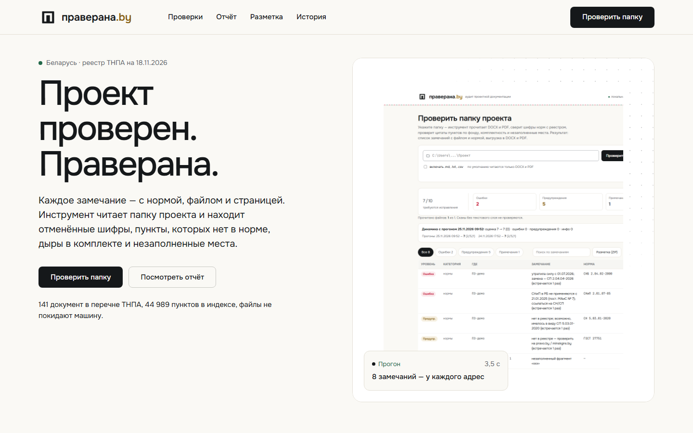
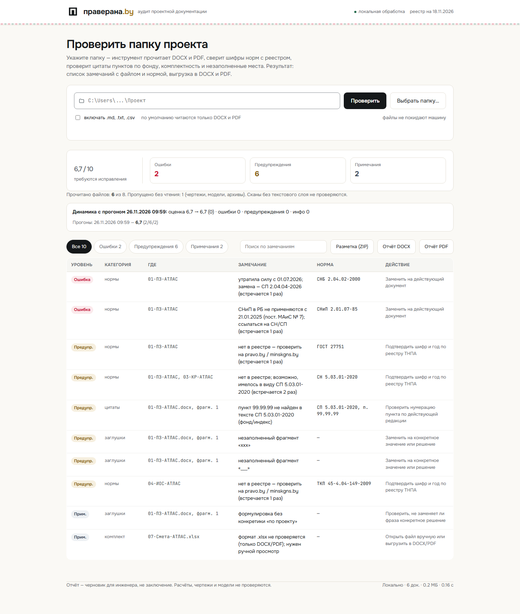
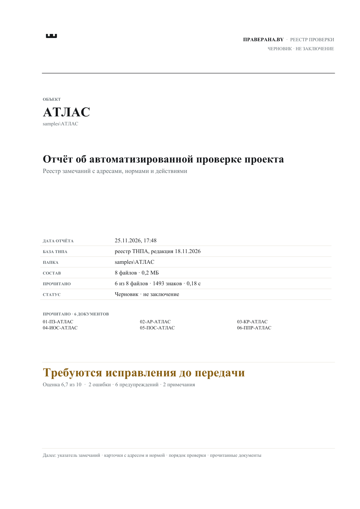
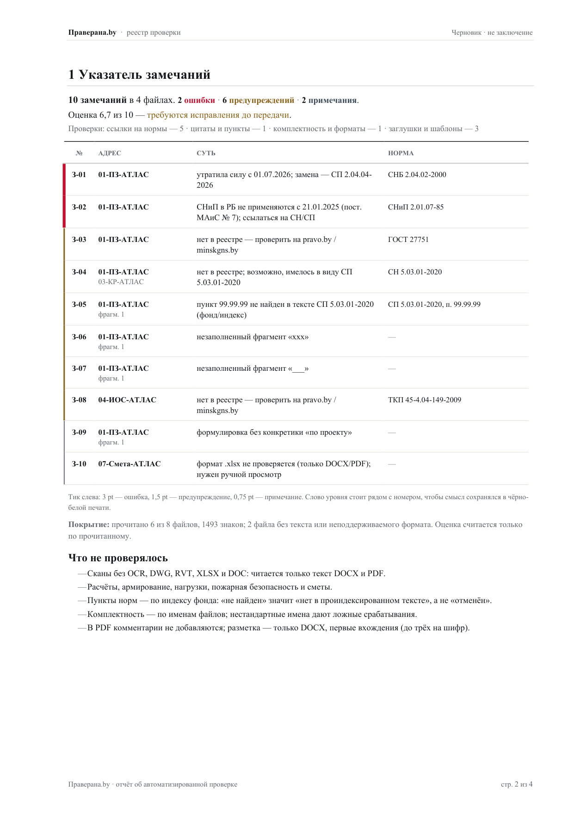

# Праверана.by

[](https://github.com/dettram/praverana/actions/workflows/ci.yml)
[](LICENSE)
[](https://www.python.org/)

Локальный аудит проектной документации по ТНПА Республики Беларусь: папка проекта → замечания
с адресом и нормой → отчёт DOCX/PDF и размеченные копии с комментариями Word.

**Модель не решает, где ошибка.** Шифры сверяются с реестром, пункты — с индексом фонда,
состав ПОС/ППР — с приложениями Г и В СН 1.03.04-2020, комплектность — по разделам проекта.
Никакого LLM в рантайме и никакой отправки документов наружу.



## Кому это нужно

- **ГИП и инженер** — быстро найти устаревшие шифры, несуществующие пункты и заглушки до
  передачи комплекта.
- **Нормоконтроль и эксперт** — получить каждое замечание с файлом, местом и нормой, которое
  можно проверить, а не «мнение рецензента».
- **Проектная команда** — сохранить историю прогонов и увидеть, что исправлено, а что появилось.

Это не заключение экспертизы и не замена нормоконтролю. Отчёт — черновик для проверяющего.

## Что проверяет

| Проверка | Что делает |
|---|---|
| Шифры ТНПА | сверяет ссылки с реестром: действует, отменён, заменён, нет в перечне |
| Пункты норм | ищет пункт в проиндексированном фонде; различает «пункта нет» и «текста нормы нет» |
| Комплектность | проверяет разделы проекта и состав приложений ПОС/ППР |
| Заглушки | находит `ХХХ`, `___`, «по проекту» и пустые места |
| Отчёт | собирает DOCX/PDF: обложка-паспорт, указатель, карточки замечаний |
| Разметка | ставит комментарии Word и подсветку в копии DOCX |
| История | сравнивает прогоны: исправлено / появилось / изменилась оценка |

В текущем фонде — 141 документ в перечне ТНПА и 44 989 пунктов в проиндексированном фонде.
Корпус в репозиторий не входит: его нужно собрать локально (см. ниже).

## Как это работает

```
папка проекта ──► engine ──► замечания (файл, место, норма, действие)
                    │
                    ├──► report.py  ──► DOCX + PDF
                    ├──► markdoc.py ──► копии DOCX с комментариями Word
                    └──► history.py ──► сравнение прогонов
```

- **Детерминированно.** Проверки — правила и локальный индекс, а не генеративный пересказ.
- **С адресом.** У замечания есть файл, фрагмент/страница, норма и действие.
- **С честным покрытием.** Сканы без OCR, DWG, RVT, XLSX и DOC не читаются; это видно в отчёте.
- **Локально.** Сервер слушает `127.0.0.1`; документы не уходят в сеть.

## Быстрый старт

Нужны Python 3.11+, [uv](https://docs.astral.sh/uv/) и Word для экспорта PDF на Windows.

```powershell
git clone https://github.com/dettram/praverana.git
cd praverana

# интерфейс: http://127.0.0.1:8765
uv run --with fastapi --with uvicorn --with python-docx --with pypdf --with python-multipart `
    python app/server.py

# CLI без интерфейса
uv run --with python-docx --with pypdf python app/engine.py `
    --path "<папка проекта>" --out result.json
```

Минимальный кит лендинга уже в `app/ui/assets`; полный кит для локального просмотра ставится
`tools/setup-kit.ps1` и не коммитится.

### Демо

```powershell
uv run --with python-docx --with openpyxl python samples/make_demo.py --out samples/demo-project
uv run --with python-docx --with pypdf python app/engine.py `
    --path samples/demo-project --out demo.json
```

Демо содержит намеренные дефекты: отменённые шифры, несуществующий пункт, заглушки, смету XLSX.
Без корпуса ТНПА проверки норм и пунктов дадут пустой результат — это ограничение, а не ошибка.

## Интерфейс



Инструмент показывает покрытие, оценку, замечания с фильтрами, историю прогонов и кнопки
выгрузки DOCX/PDF/разметки. Всё считается на машине пользователя.

## Отчёт



Отчёт — A4, один Times New Roman, цвет только у суждения. Внутри:

- обложка-паспорт: объект, дата, база ТНПА, состав, покрытие, вердикт;
- указатель замечаний: № / адрес / суть / норма;
- карточки `З-01…`: где, норма, действие, чем проверено;
- порядок проверки и список прочитанных документов.

PDF собирается через Word COM; на Linux доступен DOCX, PDF нужно собирать на Windows.
Печатные страницы отчёта:



## Приватность и безопасность

- Документы читаются локально; сервер по умолчанию слушает только `127.0.0.1`.
- Нет аккаунтов, облака, телеметрии и внешних API.
- Загруженные через браузер копии лежат во временной папке `stroy-audit-ui`; историю можно
  удалить вместе с `~/.stroy-audit`.
- В репозитории нет текстов ТНПА и проектной документации заказчиков.
- Об уязвимости — приватно через GitHub Security Advisory, не публичной issue:
  [SECURITY.md](SECURITY.md).

## Ограничения

- Читаются только DOCX и PDF с извлекаемым текстом. Сканы без OCR, DWG, RVT, XLSX и DOC —
  не проверяются; в отчёте это указано.
- «Пункт не найден» значит «нет в проиндексированном тексте», а не «отменён».
- Расчёты, армирование, нагрузки, пожарные решения и сметы не проверяются.
- Разметка ставится на первые вхождения и только в DOCX; в PDF комментарии не добавляются.
- Полный текст есть в фонде не для всех норм; остальные проверяются по статусу в реестре.

## Что нужно подготовить самому

Репозиторий **не содержит текстов норм** — по авторским правам и из-за размера фонда.
Для полноценной работы нужны:

1. **Корпус ТНПА** — папка с PDF/DOCX и реестром `02-Реестр.csv`; сборка — `scripts/`.
2. **Индекс** — `~/.stroy-audit/index.sqlite`: `scripts/build_index.py`, `scripts/build_clauses.py`.
3. **Реестр** — `scripts/refresh_registry.py`, `scripts/harvest_registry.py`.

Образец формата реестра — `data/registry-sample.csv`.

## Структура

```
app/            сервер, движок, отчёт, разметка, история, интерфейс
scripts/        корпус: индексация, поиск, реестр, ссылки, ПОС/ППР, СГП
tools/          проверки импортов и ассетов, обслуживающие скрипты
tests/          unit, contract и демо-тесты
samples/        генератор демо-проекта
data/           разобранный состав ПОС/ППР, перечень ТНПА, образец реестра
references/     методика аудита, состав ПОС/ППР, статусы норм
docs/           архитектура, дизайн, протокол GitHub, тесты, дорожная карта
.github/        CI, шаблоны issue и PR
```

## Документация

- [Архитектура](docs/ARCHITECTURE.md) — слои, поток данных, границы.
- [Дизайн](docs/DESIGN.md) и [система](docs/SYSTEM.md) — канон интерфейса и отчёта.
- [Протокол GitHub](docs/GITHUB.md) — issue → PR → merge, скриншоты, гейты.
- [Тесты](docs/TESTING.md) — пирамида, матрица модулей, команды.
- [Дорожная карта](docs/ROADMAP.md) — что дальше и в каком порядке.
- [Автономная очередь](docs/AUTONOMOUS-QUEUE.md) — порядок багфиксов без дизайна.

## Статус

Ранняя версия (`v0.x`): ядро проверок, отчёт, разметка, история и локальный интерфейс работают.
Открытые задачи и приоритеты — в [Issues](https://github.com/dettram/praverana/issues) и
[ROADMAP](docs/ROADMAP.md). Правило проекта: **нашёл — заведи issue**.

## Участие

См. [CONTRIBUTING.md](CONTRIBUTING.md): issue с воспроизведением, тест на правило, скриншоты для
UI, `smoke` и `evidence` в PR. Не присылайте тексты ТНПА, проектную документацию заказчиков и
персональные данные.

## Лицензия

Код — MIT ([LICENSE](LICENSE)). Шрифты интерфейса — Onest и JetBrains Mono, SIL Open Font License
(`app/ui/assets/fonts/OFL.txt`). Тексты нормативных документов в репозиторий не входят и не
распространяются.
